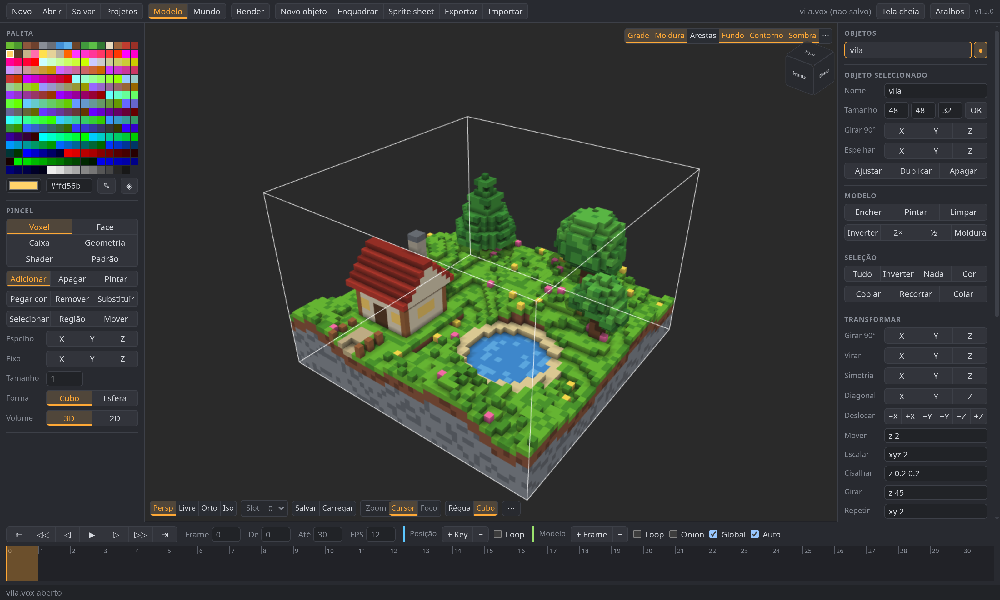
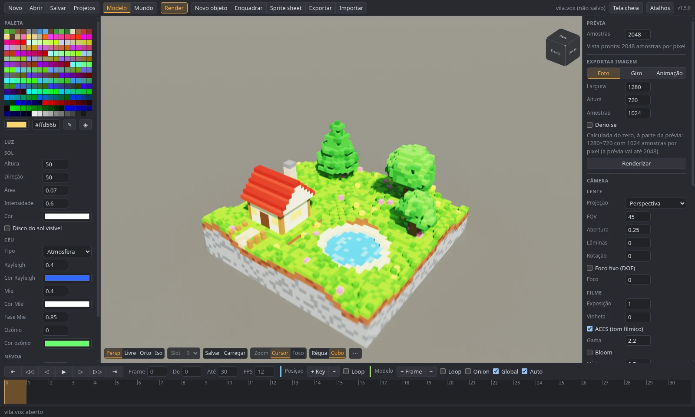

# Voxel Editor

Editor de voxels com animação que roda no navegador, feito para usar no Linux. Lê e grava o formato `.vox` do [MagicaVoxel](https://ephtracy.github.io/), inclusive as chaves de animação que a [spec pública](https://github.com/ephtracy/voxel-model) não documenta, e reproduz os atalhos, os painéis e o path tracer do MagicaVoxel 0.99.7.

O formato e a avaliação de animação vêm de engenharia reversa do binário, documentada em [`docs/magicavoxel-re.md`](docs/magicavoxel-re.md). O caminho até a paridade 1:1 está em [`docs/roadmap-v1.md`](docs/roadmap-v1.md).

> Projeto independente, sem vínculo com o MagicaVoxel ou com seu autor. Nenhum código ou binário do MagicaVoxel é distribuído aqui.





## Recursos

- **Formato `.vox` v200** com round-trip das chaves de animação, câmeras (`rCAM`), render (`rOBJ`), materiais (`MATL`), notas e chunks desconhecidos.
- **Modo Modelo:** pincéis voxel, face, caixa e geometria; espelho e modo eixo; seleção, copiar/colar, gizmo de mover, escalar e girar; operações como `rot90`, `flip`, `flood`, `shrink`, primitivas, ruído e labirinto.
- **Modo Mundo:** multisseleção, grupos, referências, booleanas, alinhamento e 8 camadas.
- **Animação:** keys de transformação e frames de modelo, timeline com multisseleção, onion skin, tempo global, empacotar modelos em animação.
- **Paleta e materiais:** seletor HSV/RGB, gradientes, importar/exportar `.png`/`.act`; difuso, emissivo, metal, vidro, nuvem e meios.
- **Shaders XS** na GPU com a API do MagicaVoxel; os 7 shaders de exemplo rodam sem mudança.
- **Path tracer** WebGL2 progressivo (`F2`): sol, céu atmosférico e IBL `.hdr`, névoa, meios com SSS, GGX com MIS, luz de área nas faces emissivas, profundidade de campo, bloom e denoise. Exporta foto, giro e animação.
- **Importar/exportar:** `obj`, `ply`, `mc`, `qb`, `xraw`, `slab`, `iso`, sprites `.png`, sprite sheet e mais.
- **Projetos no navegador:** lista no IndexedDB, autosave a cada 3 s com recuperação ao reabrir.

## Começando

Requer Node 22+, pnpm e um navegador com WebGL2. No Chromium, o botão **Tela cheia** usa a Keyboard Lock API para que `Ctrl+N`, `Ctrl+T` e `Ctrl+W` cheguem ao editor.

```sh
pnpm install
pnpm dev        # http://localhost:5173
pnpm build      # typecheck + build de produção em dist/
```

## Uso

Os atalhos seguem o `config/hotkey.txt` do MagicaVoxel 0.99.7. O botão **Atalhos** (`?`) lista todos dentro do app.

O editor tem dois modos. O **Modelo** edita os voxels do objeto selecionado, com os demais esmaecidos ao fundo. O **Mundo** organiza e anima os objetos. Alterne com `Tab` (viewport focado), pelos botões do topo ou com duplo clique: no objeto entra no modelo, no vazio volta ao mundo.

Para animar:

1. Desenhe no modo Modelo.
2. Vá para outro frame e aperte `F5`. No modo Modelo isso cria um frame de modelo, uma cópia editável (`O` liga o onion skin). No modo Mundo cria uma key de posição: mova com as setas ou arrastando, gire com `+`/`-`.
3. Salve com **Salvar** (`.vox`, abre no MagicaVoxel) ou exporte com **Exportar sprite sheet** (PNG do intervalo de frames).

### Atalhos principais

| Ação | Atalho |
|---|---|
| Girar / mover / zoom | botão direito / do meio / roda, ou `Espaço`/`Z`/`K` + arrastar com o esquerdo |
| Recentralizar / vista de face / salvar imagem | `5` / `Ctrl+5` / `6` |
| Câmera: salvar / carregar / slot | `7` / `8` / teclado numérico; perspectiva, livre (`WASDQE`), ortogonal e isométrica no canto do viewport |
| Exibir grade / arestas / fundo / moldura | `Ctrl+G` / `Ctrl+E` / `Ctrl+B` / `Ctrl+F` |
| Path tracer | `F2` |
| Key: adicionar / remover | `F5` / `F6` (frame de modelo no modo Modelo, posição no modo Mundo) |
| Frame anterior / próximo; key anterior / próxima | `,` `.`; `Ctrl+,` `Ctrl+.` (`+Shift` vai à primeira/última) |
| **Modelo:** pincel voxel / face / caixa / geometria | `V` / `F` / `B` / `L` |
| **Modelo:** tamanho do pincel voxel | `-` / `+` |
| **Modelo:** adicionar / apagar / pintar | `T` / `R` / `G` |
| **Modelo:** espelho X / Y / Z | `1` / `2` / `3` |
| **Modelo:** modo eixo X / Y / Z (o traço atravessa o modelo) | `Ctrl+1` / `Ctrl+2` / `Ctrl+3` |
| **Modelo:** encher / pintar tudo / limpar | `U` / `I` / `Delete` |
| **Modelo:** pegar cor | `Alt` + clique |
| **Mundo:** mover objeto | arrastar, setas, `PageUp`/`PageDown` |
| **Mundo:** girar 90° em Z / em X | `+` `-` / `9` `0` |
| **Mundo:** apoiar no chão / ocultar / desmarcar | `G` / `Ctrl+H` / `Ctrl+D` |
| **Mundo:** novo / apagar objeto | `Ctrl+N` (só em tela cheia; o navegador reserva) / `Delete` |
| Desfazer / refazer | `Ctrl+Z` / `Ctrl+Y` |
| Novo / abrir / salvar / salvar como | `Ctrl+P` / `Ctrl+O` / `Ctrl+S` / `Ctrl+Shift+S` (ou arraste um `.vox`) |

- O painel **Pincel**, à esquerda, tem as opções de cada modo e as ações de região: conta-gotas, remover e substituir região.
- O painel à direita renomeia, redimensiona (todos os frames de modelo; a posição no mundo é mantida), gira, espelha, duplica e apaga o objeto selecionado. Na lista, `●`/`◌` mostra/oculta e `◆` marca objetos animados.
- Toda edição, inclusive de paleta, entra no desfazer.

## Testes

```sh
pnpm test                   # vitest
pnpm typecheck
python3 tools/vox_anim.py   # self-check da implementação de referência da animação
```

Se a pasta `MagicaVoxel-0.99.7.2-win64/` existir na raiz (ela não é versionada), os testes também fazem o round-trip de todos os `.vox` de exemplo que vêm com o MagicaVoxel.

## Estrutura

```
src/format/       .vox (tipos, reader, writer), rotação, formatos de importação e exportação
src/scene/        avaliação de keyframes e do grafo de cena (port do MagicaVoxel)
src/geometry/     meshing em chunks 32³ e raycast DDA, sem dependência de three.js
src/render/       viewport three.js, câmeras, material com paleta em textura, cache de malhas, shaders XS
src/render/path-tracer/  path tracer WebGL2: volume da cena, materiais, emissores, IBL
src/editor/       estado e eventos, histórico, ferramentas, comandos de modelo, mundo, paleta e animação
src/ui/           um módulo por painel
tools/vox_anim.py implementação de referência em Python do parser e da avaliação de animação
```
